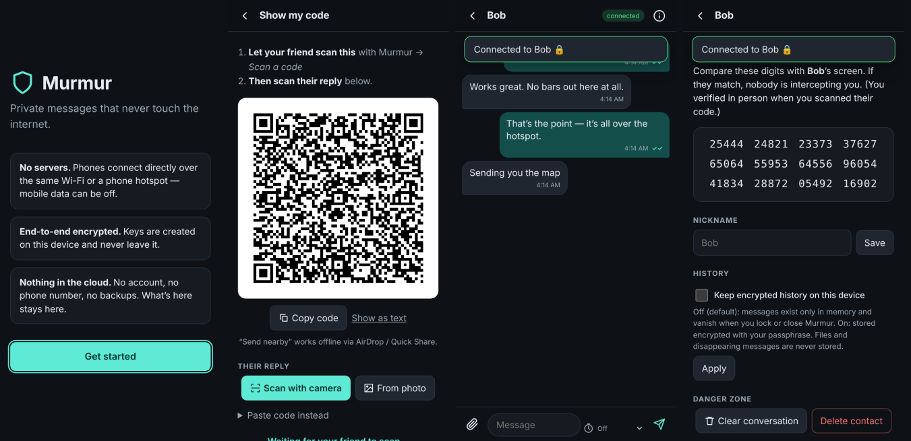

# Murmur

**End-to-end encrypted messaging in the browser — nearby with no internet at all, or far away through a relay that can't read anything. No accounts, no phone numbers, no cloud backups.**

Two phones on the same Wi-Fi — or one phone's hotspot with mobile data switched off — scan each
other's QR codes and talk directly. Friends who are far away join with an invite link, and their
messages wait (encrypted, unreadable) on a relay for up to 30 days until delivered.

**What you can do:** text · photos & videos with hidden GPS/camera data removed · hold-to-talk
voice clips (walkie-talkie) · share your location once or live, with distance and direction ·
emergency SOS to chosen contacts · small private groups · disappearing messages — with on-device
protection against phishing links, disguised files and impersonators.

```
 Alice's phone                                         Bob's phone
┌──────────────┐   ① Alice shows QR (signed invite)   ┌──────────────┐
│   Murmur     │ ───────────────────────────────────▶ │   Murmur     │
│  (PWA, keys  │   ② Bob shows QR (signed reply)      │  (PWA, keys  │
│   on device) │ ◀─────────────────────────────────── │   on device) │
│              │   ③ direct WebRTC link over the LAN  │              │
│              │ ◀═══ DTLS ═╦═ Murmur E2E (AES-GCM) ═▶ │              │
└──────────────┘            ║                         └──────────────┘
                   same Wi-Fi / hotspot — no internet, no server
```

| | |
|---|---|
| **Network** | WebRTC data channel with **zero** ICE servers → only local (host) candidates; works with no internet |
| **Signaling** | None. The QR codes *are* the signaling: compact SDP + identity key, ECDSA-signed |
| **Identity** | ECDSA P-256 key pair generated on the device; private key **non-extractable** |
| **Handshake** | Ephemeral ECDH P-256, signed by identity keys, bound to both DTLS certificate fingerprints |
| **Messages** | AES-256-GCM, a fresh key per message (HMAC hash ratchet), re-key with new ECDH every 100 msgs / 5 min |
| **Metadata** | Every message padded to a fixed size bucket (256 B / 1 KB / 4 KB / 16 KB) |
| **At rest** | Passphrase → PBKDF2-SHA256 (600k) → key-encryption key → data key → everything. History **off** by default |
| **Web hardening** | Strict CSP (`default-src 'none'`), Trusted Types, no `innerHTML`, zero third-party code, zero dependencies |
| **Offline app** | Service worker caches every file after verifying its SHA-256; airplane-mode capable |
| **Far away** | Double Ratchet (Signal's design) over an untrusted relay; relay stores only ciphertext, deletes on delivery, 30-day cap |
| **Media privacy** | EXIF/XMP/GPS stripped from JPEG/PNG/WebP and QuickTime metadata zeroed in MP4/MOV — byte-level, no quality loss |
| **Groups** | Pairwise fan-out over each member's own E2E link; only the creator can change membership |



> **Status: complete and tested, not independently audited.** Read [docs/THREAT-MODEL.md](docs/THREAT-MODEL.md)
> before trusting it with anything that could hurt someone.

---

## Quick start (your computer)

Requires **Node.js 22+**. There is nothing to `npm install` for the app itself.

```powershell
cd murmur
npm test            # 99 unit tests: crypto, protocol, ratchet, relay, scam checks, media, groups, QR, build
npm run build       # src/ → dist/  (prints the build fingerprint)
npm run serve       # http://localhost:8080
```

Open two **different** browser profiles (e.g. a normal and a private window) at
`http://localhost:8080`, create an identity in each, then *Show my code* in one and
*Scan a code* → *Paste code instead* in the other. The text code button is *Show as text*.

### Browser end-to-end tests (optional)

```powershell
npm i -D playwright
npx playwright install chromium
npm run test:e2e
```

Two isolated Chromium profiles onboard, pair, chat (including a 150-message burst across
re-keys), send files, lock/unlock, reload with the network **offline** from the service worker,
reconnect while **every HTTP request is blocked**, verify CSP/Trusted Types, and panic-wipe.
A second test feeds each "phone" the other's QR through Chrome's fake camera, so the real
scanning path is exercised. The camera test needs `python3` with `opencv-python` and `numpy`;
without them it is skipped.

---

## Put it on your phones

A web app has to be **downloaded once over HTTPS** (browsers only allow the camera and offline
install on secure origins). After that first load it runs with no network at all.

1. Push this folder to a GitHub repository.
2. In the repository: **Settings → Pages → Source: GitHub Actions**. The included workflow
   (`.github/workflows/pages.yml`) runs the tests, builds `dist/` and publishes it.
3. On each phone, open `https://<you>.github.io/<repo>/` once while online, then:
   - **iPhone (Safari):** Share → *Add to Home Screen*
   - **Android (Chrome):** ⋮ → *Install app* / *Add to Home screen*
4. Open it from the home screen. Settings shows "Installed — works with no network".

### Second host (recommended): Cloudflare Pages

Some networks can't reach GitHub Pages' servers (`185.199.108–111.153`) at all — the page just
stalls. Publish to a second provider that **serves the files unmodified**:

1. dash.cloudflare.com → **Workers & Pages** → **Create application** → **Pages** →
   **Connect to Git** (or *Import an existing Git repository*) → pick this repository.
2. **Framework preset:** None · **Build command:** `node tools/build.mjs` · **Build output directory:** `dist`
3. Deploy. `_headers` applies Murmur's security headers there automatically.

Cloudflare redirects `/index.html` to `/`. The service worker therefore downloads the page from
`./` (which every host serves) and still refuses any redirect it didn't expect. The local dev
server copies Cloudflare's redirect so the offline e2e test covers it.

**Updates.** After you deploy, each phone downloads the new build in the background, checks
every file's hash, and then shows **"Restart to update"** with the new fingerprint (home screen,
lock screen and Settings → *Check for update*). Nothing changes until that tap — so two friends
can compare fingerprints first.

**Avoid hosts that inject into your pages.** Netlify's free plan adds a "Powered by Netlify"
script to every HTML page and only lets paid plans turn it off. Murmur's service worker sees
that `index.html` no longer matches its build hash and **refuses to install** — so offline
mode never turns on (Settings and a red banner say so). That refusal is the security feature
working: an injected script runs with Murmur's full permissions.

Both hosts serve byte-identical code — compare the **build fingerprint** in Settings.
Test whether a network can reach a host first: `curl.exe -4 -I --max-time 15 https://<site>`
Test whether a host alters the page: `curl.exe -s https://<site>/index.html | Select-String -Pattern "<script" -SimpleMatch`
— Murmur's own page has exactly one line with `<script`.

### Using it with no internet

1. One person turns on their **phone hotspot** (mobile data can be **off**), the other joins it.
   Any shared Wi-Fi works too — *except* networks with "client isolation" (many hotels, cafés).
2. Alice: **Show my code**. Bob: **Scan a code** → point at Alice's screen.
3. Bob's phone now shows a reply code. Alice: **Scan with camera** → point at Bob's screen.
4. Connected 🔒. Compare the **safety number** (contact ⓘ) if you want to be thorough.

Each new session needs this exchange again. That's inherent to having no server: there is no
one to tell Alice's phone where Bob's phone is. Contacts are remembered, so a reconnect simply
recognises them (and refuses a code from a *different* key claiming to be them).

---

## Internet mode: friends who are far away

Nearby phones talk directly over the same Wi‑Fi or hotspot, with no server involved. For friends
somewhere else, Murmur uses a small relay that **can't read anything**:

- Messages are encrypted on the phone with the **Double Ratchet** (the design Signal uses).
- The relay stores only unreadable data. It **deletes each message once delivered**, and anything unclaimed **after 30 days**.
- If you write while offline, the message is encrypted immediately, waits on your phone, and sends itself when you're back online.
- **Invite by link:** send it by text, WhatsApp or email. It works once and expires after 7 days. Remote contacts show **not verified** until you compare safety numbers on a call.
- **Scam protection** runs on the phone:
  - links are never one-tap, and lookalike and fake-brand domains are flagged
  - files are checked by their real contents, and disguised programs are caught
  - names imitating your contacts are flagged
  - strangers who use your invite arrive as a **request**, with links and files locked

### Deploy the relay (Cloudflare, free plan)
The relay code is in `relay/`. It runs on Workers with Durable Objects (SQLite).
1. dash.cloudflare.com → **Workers & Pages** → **Create application** → **Workers** → **Import a repository** → pick this repo.
2. **Project name:** `murmur-relay`. It must match `name` in `relay/wrangler.jsonc`.
3. **Root directory** (advanced): `relay` · **Build command:** *(empty)* · **Deploy command:** `npx wrangler deploy`
4. Deploy. `wrangler.jsonc` attaches **relay.princeisgenius.com** as a custom domain and only accepts requests from `https://murmur.princeisgenius.com`.
5. Check it: `curl.exe -s https://relay.princeisgenius.com/v1/health` → `ok`

To use another domain, change `routes` and `ALLOWED_ORIGINS` in `relay/wrangler.jsonc`, and `RELAY_URL` in
`src/js/config.js` together with the relay origin in the CSP in `src/index.html`.

Run it locally: `node relay/node/server.mjs --port 8787 --origin http://localhost:8080`, then
`node tools/build.mjs --relay http://127.0.0.1:8787` and `npm run serve`.

## Features in detail

| Feature | Nearby (no internet) | Far away (relay) | Notes |
|---|---|---|---|
| Text, receipts ✓✓, disappearing | ✅ | ✅ | |
| Photos & videos | ✅ | ✅ (sent in 192 KiB chunks) | Hidden location/camera data removed before sending; only real images/videos are displayed |
| Walkie-talkie | ✅ | ✅ | Hold the mic button, release to send (2 min max). Needs microphone permission |
| Location | ✅ | ✅ | Once, or live for 15 min / 1 h (updates every 30 s while Murmur is open). Shows distance & direction — no map server. "Map" opens your map app only after a warning |
| SOS | ✅ | ✅ (queued if no signal) | Hold 1.5 s. Sends your message + GPS to chosen contacts. **Cannot call emergency services** |
| Groups | ✅ | ✅ | Up to 20. The creator forwards text and location to members who aren't each other's contacts ("via group"); files go to your direct contacts in the group |
| Scam protection | ✅ | ✅ | Links never open in one tap; lookalike/brand-fake domains, hidden destinations and disguised files are flagged |

### Checking a deployment
- `node tools/site-check.mjs https://murmur.princeisgenius.com` — fetches every file like a phone would and proves it's **byte-for-byte the tested build** (catches CDN/host injection), and checks the security headers.
- `node tools/relay-smoke.mjs https://relay.princeisgenius.com` — acts like a phone against the relay: health, WebSocket, mailbox login, keep-alive, delivery, deletion.

## Project layout

```
murmur/
├── src/                      ← the app, exactly as served (no bundler, no minifier)
│   ├── index.html            CSP + Trusted Types policy declaration
│   ├── sw.template.js        offline engine (build injects file hashes)
│   ├── css/app.css
│   └── js/
│       ├── app.js            UI controller & views
│       ├── core/             ← security-critical, UI-free, unit-tested in Node
│       │   ├── bytes.js        encoders (base64url, base45), binary reader/writer
│       │   ├── crypto.js       WebCrypto wrappers — no home-made primitives
│       │   ├── vault.js        passphrase → KEK → DEK → encrypted records
│       │   ├── storage.js      IndexedDB / in-memory stores
│       │   ├── identity.js     contact ids, 60-digit safety numbers
│       │   ├── sdp.js          SDP ⇄ ~70-byte compact form
│       │   ├── pairing.js      signed invite/reply codes
│       │   ├── session.js      handshake, ratchet, padding, re-key
│       │   ├── transport.js    serverless WebRTC data channel
│       │   └── conversation.js ties it together; text, typing, files
│       ├── qr/               ← QR encoder + camera decoder, written from the spec
│       │   ├── rs.js           Reed–Solomon over GF(256)
│       │   ├── qr.js           symbol structure (versions 1–40, masks, layout)
│       │   ├── encode.js       text → modules
│       │   ├── decode.js       camera frame → text (finder/alignment/homography/RS)
│       │   ├── worker.js       decoder off the main thread
│       │   └── scanner.js      camera loop; native BarcodeDetector when present
│       └── ui/               dom.js (safe element builder), trusted.js (TT policy)
├── tools/build.mjs           dist/ + SHA256SUMS + build fingerprint + sw.js
├── tools/serve.mjs           zero-dependency static server with security headers
├── test/unit/                node --test (no dependencies)
├── test/e2e/run.mjs          Playwright, two browsers, network guard, fake camera
└── docs/                     PROTOCOL · ARCHITECTURE · THREAT-MODEL · LEARNING
```

## Documentation

- **[docs/ARCHITECTURE.md](docs/ARCHITECTURE.md)** — how the pieces talk, why this design, what fails and how to debug it
- **[docs/PROTOCOL.md](docs/PROTOCOL.md)** — byte-level specification of codes, handshake, frames, re-key
- **[docs/THREAT-MODEL.md](docs/THREAT-MODEL.md)** — what Murmur defends against, and what it honestly can't
- **[docs/LEARNING.md](docs/LEARNING.md)** — guided tour + exercises (debugging, attacking, extending)

## Verified vs. not yet verified

| Verified here (automated) | Needs real-device testing |
|---|---|
| Crypto, handshake, ratchet, re-key under load, every tamper/replay/impostor case | iOS Safari and Firefox (SDP rebuild was verified against Chromium) |
| QR encoder ⇄ OpenCV in both directions; decoder under rotation, keystone, blur, noise | Phone cameras in poor light; very old phones' decode speed |
| Two-browser pairing, chat, files, offline reload, zero HTTP during use (Chromium) | Phone hotspots that block multicast DNS (`.local` candidates) |
| CSP + Trusted Types enforcement; data-at-rest is ciphertext | GitHub Pages workflow (action versions checked Nov 2026; not run from here) |

## License

MIT — see [LICENSE](LICENSE).
