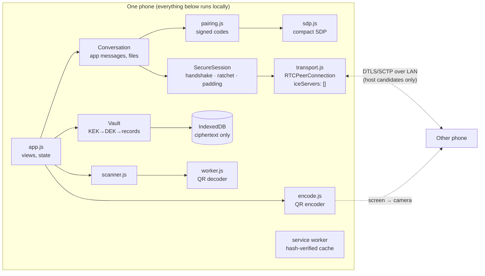
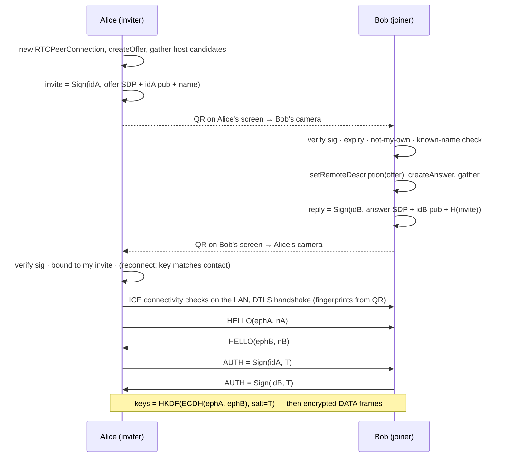

# Architecture

## The constraint that shapes everything

"No internet, no server, in a browser" rules out most designs before we start:

| Option | Offline? | In a browser? | Verdict |
|---|---|---|---|
| Central relay server (Signal, WhatsApp model) | ✗ | ✓ | Violates "no internet" and "nothing in the cloud" |
| Bluetooth mesh (Briar, Bridgefy model) | ✓ | ✗ | Web Bluetooth can only act as a *client*; two browsers can never find each other |
| Wi-Fi Direct / Nearby Connections | ✓ | ✗ | Native-only APIs |
| **WebRTC over the local network, signaled by QR** | ✓ | ✓ | **Chosen.** Needs a shared Wi-Fi/hotspot; no internet |
| Copy-paste ciphertext through some other channel | ✓ | ✓ | Works, but unusable for chat |

The price of the chosen design: both people must be on the same network at the same time, and
every session starts with a QR exchange. A native Android app (Kotlin, Nearby Connections or
Wi-Fi Direct) could remove the shared-network requirement and enable multi-hop mesh — that's the
natural "v2" if Murmur outgrows the browser. The protocol in PROTOCOL.md is transport-agnostic, so
a native client could speak it unchanged over a different pipe.

## Components and how they talk

**Layering rule:** everything in `js/core/` is UI-free and runs unchanged in Node, which is why the
security-critical code has fast, deterministic unit tests. The UI never touches keys; it holds a
`Vault` and `Conversation` objects and calls their methods.

### Pairing sequence

## Why each piece is the way it is

- **WebCrypto only, no crypto library.** Fewer lines we own, native constant-time implementations,
  and non-extractable keys — which no JS library can offer. Trade-off: no X25519/Argon2
  everywhere yet, so P-256 and PBKDF2 (both still sound; Argon2 would be stronger against GPU cracking).
- **Own E2E layer on top of DTLS.** DTLS authenticates *browsers* (throwaway certs). Murmur
  authenticates *people* (identity keys), adds per-message forward secrecy, and binds the two.
- **Strict in-order sequence numbers instead of skipped-key windows.** The data channel is ordered
  and reliable, so Signal's out-of-order machinery would only add attack surface.
- **Offerer-only re-keying.** Simultaneous re-key initiation is the classic source of ratchet
  desync bugs; giving one side the job removes the race entirely.
- **Base45 in QR alphanumeric mode.** Binary QR payloads get mangled by text-only scanners
  (`BarcodeDetector.rawValue` is a string); base45 is text-safe and nearly as dense.
- **Own QR decoder.** iOS Safari has no `BarcodeDetector`, and pulling a large third-party decoder
  into a security app adds supply-chain risk. Ours is ~400 lines, cross-validated against OpenCV.
- **No build tooling.** What's in `src/` is byte-for-byte what runs. `SHA256SUMS` and the build
  fingerprint let anyone confirm two installs are identical.

## What can fail, and how to debug it

| Symptom | Likely boundary | How to confirm | Fix |
|---|---|---|---|
| "Could not reach your friend's phone" after both scans | ICE (network) | `chrome://webrtc-internals` → candidate pairs all `failed` | Same network? Disable client isolation / use a hotspot. If candidates are `*.local` and the hotspot blocks multicast, mDNS can't resolve — try another hotspot |
| "No host candidates" on code creation | No network interface | Turn on Wi-Fi (doesn't need internet) | Join any Wi-Fi/hotspot first |
| "Peer failed to prove its identity" | Handshake | Expected if someone is interfering; otherwise version mismatch | Rescan in person; compare build fingerprints |
| "Signature check failed — code was altered" | Pairing code | Pasted code truncated? | Use QR, or copy again |
| "This reply belongs to a different invite" | Code binding | Old reply scanned | Start over: new invite, new reply |
| "missing message" / "replayed message" | Ratchet | Should never happen on a healthy channel | It's either an attack or a bug — capture `webrtc-internals` and the console; reconnect |
| Camera shows but never scans | QR decode | Try *From photo* with a screenshot of the code | Brighter screen, hold steadier, fill ~60% of the frame |
| App won't load offline | Service worker | Settings → "Installed" line; DevTools → Application → Service Workers | Load once online; an integrity mismatch aborts install (check `SHA256SUMS`) |

Debugging discipline: establish expected vs. actual, find the **boundary** (pairing code → SDP →
ICE → DTLS → Murmur handshake → app message), test the smallest thing at that boundary, fix the
root cause. The unit tests mirror those boundaries, so a failing layer usually has a failing test.

## Testing map

| Layer | Test | Technique |
|---|---|---|
| bytes / base45 | `core.test.mjs` | RFC 9285 vectors, random round-trips |
| SDP codec | `core.test.mjs` | real Chrome SDP fixture, IPv6/TCP variants, injection |
| pairing | `core.test.mjs` | every bit-flip rejected, expiry, binding, forged identity |
| vault | `core.test.mjs` | ciphertext-only storage, wrong pass, wipe, AAD swap, re-wrap |
| session | `core.test.mjs` | impostor, channel-binding mismatch, tamper, replay, gap, off-curve key, re-key under load, key erasure |
| QR | `qr.test.mjs` | RS fuzzing; all 40 versions × 4 ECC; camera distortions; OpenCV both ways |
| whole app | `e2e/run.mjs` | two Chromium profiles; network guard; offline; CSP/TT; fake camera |
