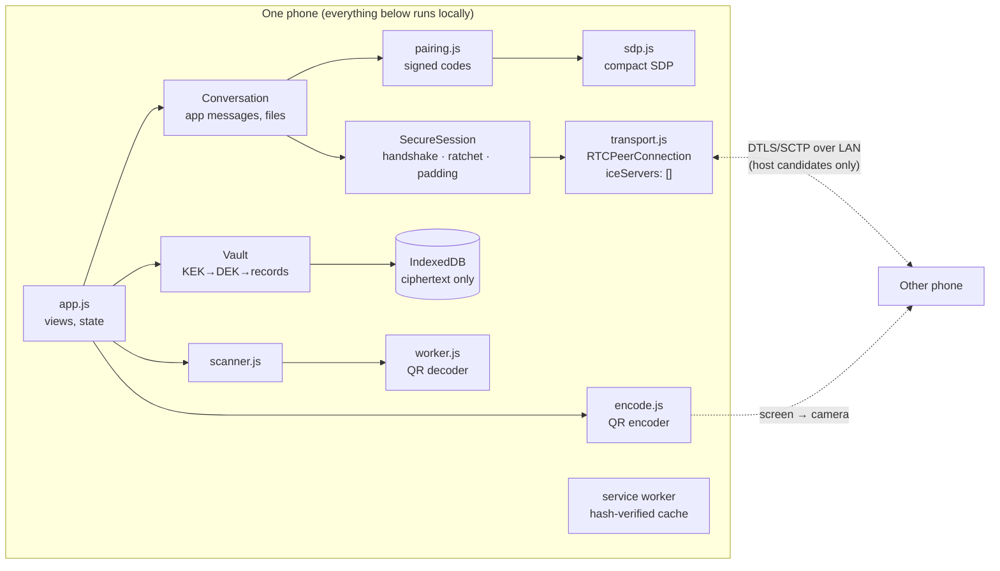
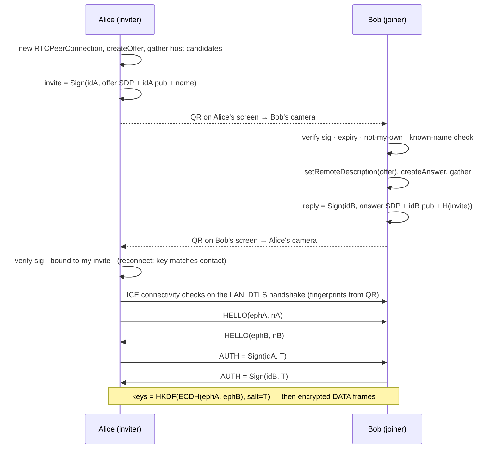

# Architecture

## The constraint that shapes everything

"No internet, no server, in a browser" rules out most designs before we start:

| Option | Offline? | In a browser? | Verdict |
|---|---|---|---|
| Central relay server (Signal, WhatsApp model) | ✗ | ✓ | Violates "no internet" and "nothing in the cloud" |
| Bluetooth mesh (Briar, Bridgefy model) | ✓ | ✗ | Web Bluetooth can only act as a *client*; two browsers can never find each other |
| Wi-Fi Direct / Nearby Connections | ✓ | ✗ | Native-only APIs |
| **WebRTC over the local network, signaled by QR** | ✓ | ✓ | **Chosen.** Needs a shared Wi-Fi/hotspot; no internet |
| Copy-paste ciphertext through some other channel | ✓ | ✓ | Works, but unusable for chat |

The price of the chosen design: both people must be on the same network at the same time, and
every session starts with a QR exchange. A native Android app (Kotlin, Nearby Connections or
Wi-Fi Direct) could remove the shared-network requirement and enable multi-hop mesh — that's the
natural "v2" if Murmur outgrows the browser. The protocol in PROTOCOL.md is transport-agnostic, so
a native client could speak it unchanged over a different pipe.

## Components and how they talk



**Layering rule:** everything in `js/core/` is UI-free and runs unchanged in Node, which is why the
security-critical code has fast, deterministic unit tests. The UI never touches keys; it holds a
`Vault` and `Conversation` objects and calls their methods.

### Pairing sequence



## Why each piece is the way it is

- **WebCrypto only, no crypto library.** Fewer lines we own, native constant-time implementations,
  and non-extractable keys — which no JS library can offer. Trade-off: no X25519/Argon2
  everywhere yet, so P-256 and PBKDF2 (both still sound; Argon2 would be stronger against GPU cracking).
- **Own E2E layer on top of DTLS.** DTLS authenticates *browsers* (throwaway certs). Murmur
  authenticates *people* (identity keys), adds per-message forward secrecy, and binds the two.
- **Strict in-order sequence numbers instead of skipped-key windows.** The data channel is ordered
  and reliable, so Signal's out-of-order machinery would only add attack surface.
- **Offerer-only re-keying.** Simultaneous re-key initiation is the classic source of ratchet
  desync bugs; giving one side the job removes the race entirely.
- **Base45 in QR alphanumeric mode.** Binary QR payloads get mangled by text-only scanners
  (`BarcodeDetector.rawValue` is a string); base45 is text-safe and nearly as dense.
- **Own QR decoder.** iOS Safari has no `BarcodeDetector`, and pulling a large third-party decoder
  into a security app adds supply-chain risk. Ours is ~400 lines, cross-validated against OpenCV.
- **No build tooling.** What's in `src/` is byte-for-byte what runs. `SHA256SUMS` and the build
  fingerprint let anyone confirm two installs are identical.

## What can fail, and how to debug it

| Symptom | Likely boundary | How to confirm | Fix |
|---|---|---|---|
| "Could not reach your friend's phone" after both scans | ICE (network) | `chrome://webrtc-internals` → candidate pairs all `failed` | Same network? Disable client isolation / use a hotspot. If candidates are `*.local` and the hotspot blocks multicast, mDNS can't resolve — try another hotspot |
| "No host candidates" on code creation | No network interface | Turn on Wi-Fi (doesn't need internet) | Join any Wi-Fi/hotspot first |
| "Peer failed to prove its identity" | Handshake | Expected if someone is interfering; otherwise version mismatch | Rescan in person; compare build fingerprints |
| "Signature check failed — code was altered" | Pairing code | Pasted code truncated? | Use QR, or copy again |
| "This reply belongs to a different invite" | Code binding | Old reply scanned | Start over: new invite, new reply |
| "missing message" / "replayed message" | Ratchet | Should never happen on a healthy channel | It's either an attack or a bug — capture `webrtc-internals` and the console; reconnect |
| Camera shows but never scans | QR decode | Try *From photo* with a screenshot of the code | Brighter screen, hold steadier, fill ~60% of the frame |
| App won't load offline | Service worker | Settings → "Installed" line; DevTools → Application → Service Workers | Load once online; an integrity mismatch aborts install (check `SHA256SUMS`) |

Debugging discipline: establish expected vs. actual, find the **boundary** (pairing code → SDP →
ICE → DTLS → Murmur handshake → app message), test the smallest thing at that boundary, fix the
root cause. The unit tests mirror those boundaries, so a failing layer usually has a failing test.

### Lesson: two security policies
On Cloudflare/Netlify the CSP arrives **twice**: as an HTTP header (`src/_headers`) and in a
`<meta>` tag (`index.html`). The browser enforces **both**. Internet mode once worked in tests but
failed on every real phone, because the relay origin was only added to the `<meta>` tag. The
console said: *Connecting to 'wss://relay…' violates … "connect-src 'self' blob:"*. Fixes:
- `build.test.mjs` fails if the two policies differ.
- `tools/serve.mjs` now sends the `_headers` headers, so the browser tests enforce both.
- `tools/relay-smoke.mjs` checks a deployed relay step by step: health, WebSocket, auth, ping, deposit, delivery.

Debugging recipe that found it: the server worked (smoke test) but the app didn't, so the fault
had to be in the browser. Open DevTools on a laptop, reproduce, and read the Console.

## Testing map

| Layer | Test | Technique |
|---|---|---|
| bytes / base45 | `core.test.mjs` | RFC 9285 vectors, random round-trips |
| SDP codec | `core.test.mjs` | real Chrome SDP fixture, IPv6/TCP variants, injection |
| pairing | `core.test.mjs` | every bit-flip rejected, expiry, binding, forged identity |
| vault | `core.test.mjs` | ciphertext-only storage, wrong pass, wipe, AAD swap, re-wrap |
| session | `core.test.mjs` | impostor, channel-binding mismatch, tamper, replay, gap, off-curve key, re-key under load, key erasure |
| QR | `qr.test.mjs` | RS fuzzing; all 40 versions × 4 ECC; camera distortions; OpenCV both ways |
| build output | `build.test.mjs` | every precached file exists with its hash; host config never precached; fingerprint covers the offline engine; reproducible |
| double ratchet | `ratchet.test.mjs` | ping-pong across DH steps; out-of-order/lost; replay; tamper leaves state intact; forward secrecy; persistence; DoS gap |
| remote invites | `invite.test.mjs` | join reveals nothing to the relay; altered/expired/own invites; swapped invite detectable; binding to invite |
| relay | `relay.test.mjs` | the real Worker code on a Node runtime shim: offline delivery, ack-delete, owner-only read, Origin checks, limits, 30-day alarm, opaque storage |
| internet mode | `remote.test.mjs` | two phones over the relay with real vaults: offline writer, offline reader, relock, reused invite, live bootstrap, no plaintext at the relay |
| scam protection | `safety.test.mjs` | blocked schemes, homographs (punycode), brand lookalikes, hidden destinations, file sniffing, disguised programs, lookalike names |
| media privacy | `media.test.mjs` | real PIL/ffmpeg files with GPS, camera and comments; secrets gone, pixels identical (PIL), orientation kept, video still decodes (ffprobe), damaged files refused |
| location & groups | `geo-groups.test.mjs` | known distances and bearings; coordinate validation; only the creator changes the roster; replayed rosters refused; removal; ID generator checked against the receiver's rules |
| deployment | `sitecheck.test.mjs` | the live-site checker passes on an honest host and names the injected script on a tampering one |
| whole app | `e2e/run.mjs` | two Chromium profiles + local relay; network guard; offline; CSP/TT; fake camera; invite link, request gating, scam modal, offline queue, verification; **3 people**: GPS-free photo, location distance/direction, voice messages with fake mic (touch hold → in-bar review → 🗑 sends nothing; hands-free timer → ⏸ → review; slide-to-cancel; leaving the chat mid-recording discards; ➤ sends; received bubble has a decoded length, play/pause/1.5×, and no file name/size/Save; hands-free ➤ sends at once; instant mode), photo preview where Cancel sends nothing, phone Save via share sheet, SOS hold (and a too-short tap that must not send), group via creator forwarding, member removal; **updates**: new build verified, announced with its fingerprint, applied on tap, data kept |

### Internet mode components
```
app.js ──► remote.js ──► ratchet.js (Double Ratchet)  ┐
              │  └────► invite.js (links, joins)       ├─ crypto.js (WebCrypto only)
              ▼                                        ┘
   relay: router.js (Worker) ──► inbox.js (one Durable Object per mailbox, SQLite)
```

## Lesson: the outbox that rewrote itself

The relay outbox used to be ONE encrypted vault record holding every queued envelope.
Each `send()` re-encrypted and rewrote the whole queue, and so did each successful post.
For a 2-minute voice clip (≈15 chunks of ~350 KB) that is ~75 MB of AES + IndexedDB work
on a phone — minutes of "nothing happening". Now the queue is a tiny index
(`remote/outbox2`) plus one record per envelope (`remote/ob/<seq>`): every byte is written
once and deleted once. Bytes are written before the index points at them, and the index
is updated before the bytes are deleted, so a crash can leave an orphan but never a
dangling pointer. Older builds' single record is migrated on load.
`test/unit/remote.test.mjs` measures bytes written; the old design does not finish it.

## Lesson: two races found by running the suite twice

1. **The half-open session.** `openVault()` set `S.vault` before `S.settings` was loaded. The
   auto-lock timer treats `S.vault` as "ready" and read `S.settings.autoLockMin` → crash, only when
   the timer ticked inside that gap. Fix: load everything, *then* publish `S.vault`.
2. **The lock screen that wasn't ready.** The remembered username loads asynchronously; the test
   (and a fast thumb) could submit first. The form now marks `data-ready` once it has loaded.

Rule of thumb: whatever other code uses as a "ready" flag must be assigned **last**.

## New modules (Nov 2026)
| Module | Pure? | Tests |
|---|---|---|
| `core/edits.js` — edit/delete windows, author checks | yes | `test/unit/edits.test.mjs` |
| `core/profile.js` — username rules, login hash, profile validation, per-contact call flags | yes | `test/unit/profile.test.mjs` |
| `core/call.js` — WebRTC call engine + signal validation + `callDecision()` | engine needs a browser | `test/unit/call.test.mjs` + e2e "voice & video calls" and the relay call in "phase 1" |
| `core/waveform.js` — bar heights, live mic level, clock text, speeds, seek maths | yes | `test/unit/waveform.test.mjs` |
| `ui/voice.js` — voice bubble player + recorder bar (needs MediaRecorder/WebAudio) | browser only | e2e "phase 1" voice section |
| `relay/src/router.js` `/v1/turn` | — | `test/unit/relay.test.mjs` (fake Cloudflare API, port-53 filter, Origin check, rate limit, STUN fallback) |

## Lesson: the walkie-talkie that only failed on real fingers

On a touchscreen, lifting a finger fires `pointerup` **and then `pointerleave`**. The recorder
treated `pointerleave` as "slid away — cancel", and since stopping a MediaRecorder is
asynchronous the clip was still "recording" at that instant: every iPhone clip was silently
discarded. The browser tests used a **mouse**, which doesn't fire that second event — so they
passed. Fix: pointer capture, and cancel only by *distance* (> 90 px). The e2e suite now drives
the button with real touch event sequences (`touchHold`), plus tap-to-lock and slide-to-cancel.
Lesson: when a bug survives a fix, test the exact input the user has, not a convenient stand-in.

## Lesson: state that must outlive a re-render
The chat screen is redrawn from scratch whenever something changes (a relay reconnect, a
contact's new photo). That was harmless for text, but the voice recorder used to live *inside*
the composer: a redraw mid-recording would have orphaned a running MediaRecorder (microphone
left on, clip lost) and wiped a clip you were reviewing. Now `S.voiceRec` holds one recorder per
chat and each redraw re-attaches the same button and bar; bubble players are cached by blob URL
(`PLAYERS`) so a playing note keeps playing. Only *leaving* the chat (or locking) stops them —
`render()` compares the screen key, and `dropFileUrl()` stops a player before its URL is revoked.
The same redraw silently **wiped half-typed messages** — and that, not the network, was why the
e2e suite occasionally "lost" the first message after connecting (a redraw landed between typing
and tapping Send, so Send sent an empty box; the other phone had already seen "typing…"). It
failed about 1 run in 4 on the old code. Drafts now live in `S.drafts` (memory only, cleared on
lock) and `render()` restores focus and cursor; the "profile photo" e2e test types on one phone
while the other changes its photo, and fails on the old code.
Lesson: before putting long-lived state in a view, ask what happens when that view is rebuilt —
and when a "flaky" test fails the same way twice, it is usually a real bug wearing a disguise.

The waveform is computed on each phone from the decrypted audio (`decodeAudioData`), never sent:
a sender can't make a clip look different from what it sounds like, and the protocol didn't change.

## History storage
`history/<contact>` is the list; each file's bytes are their own record `media/<contact>/<message>`,
written once and deleted when the message is deleted (for me / for everyone), cleared, aged out
(2,000 messages) or when history is switched off. `contact.media` lists what is stored, so orphan
cleanup never needs to scan storage. Saves are serialized per chat (`persistQueue`).
